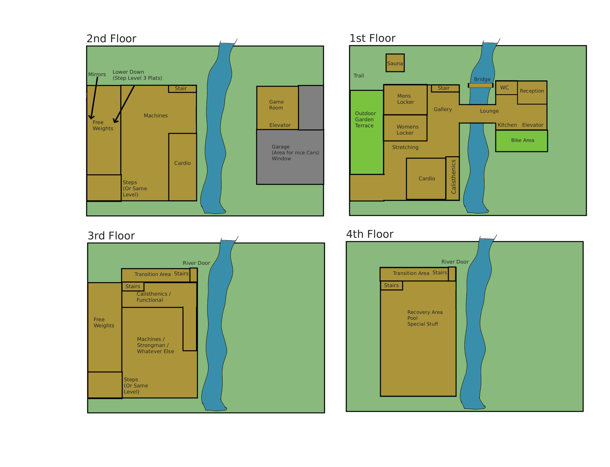
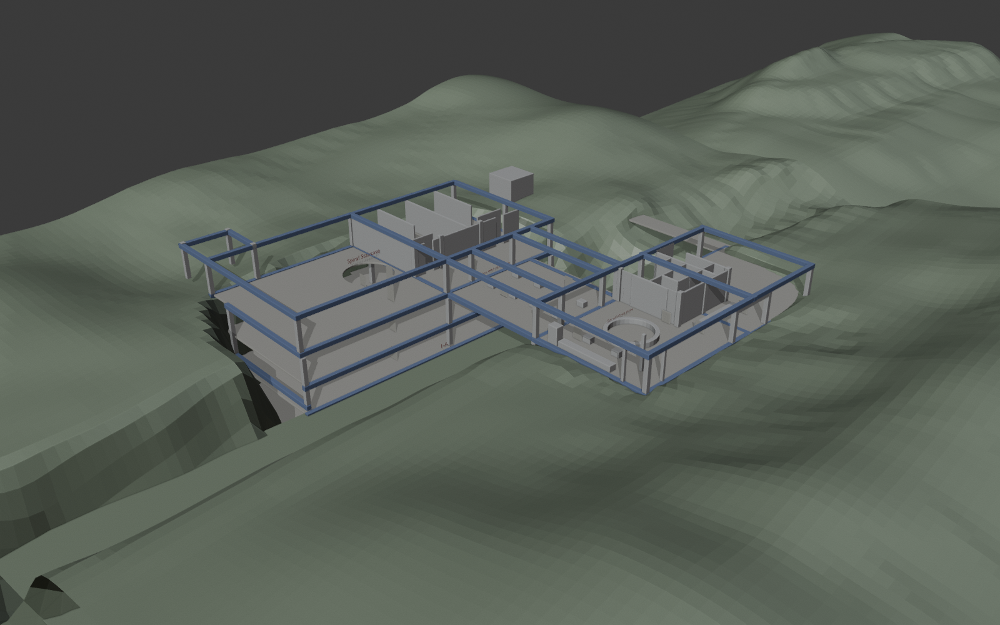
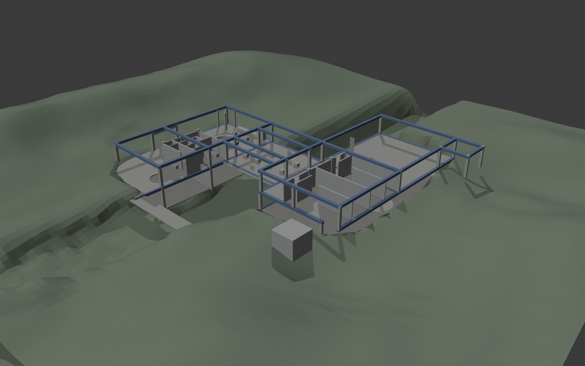
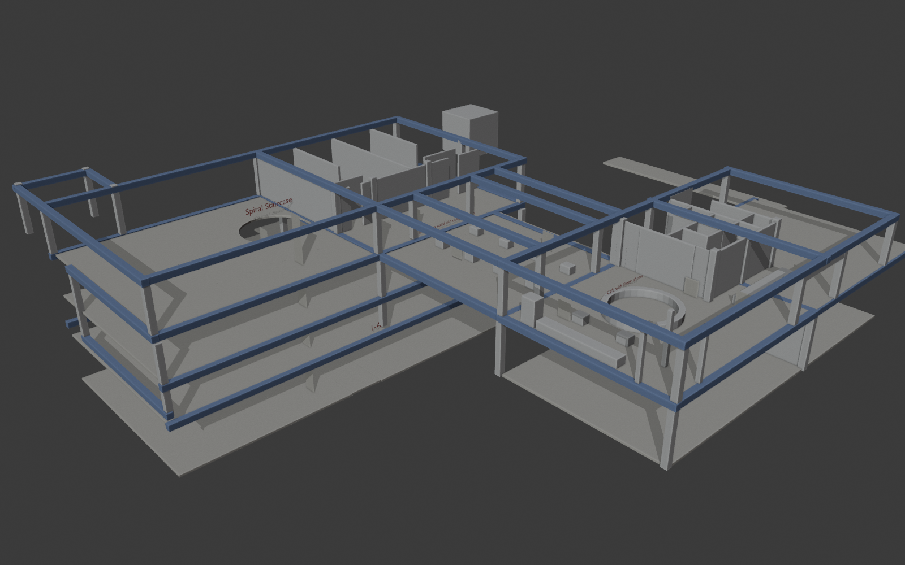
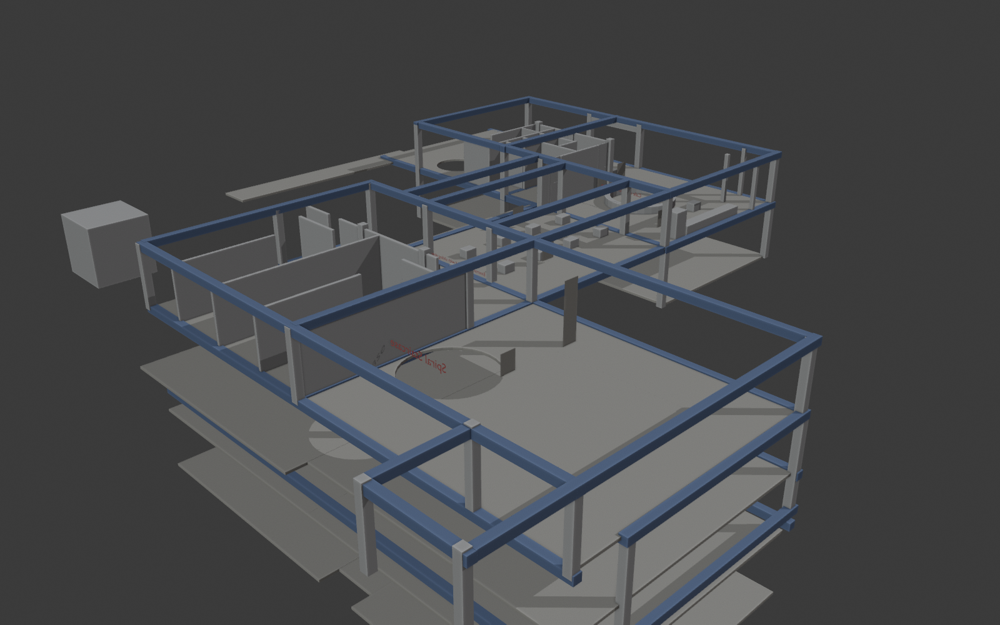
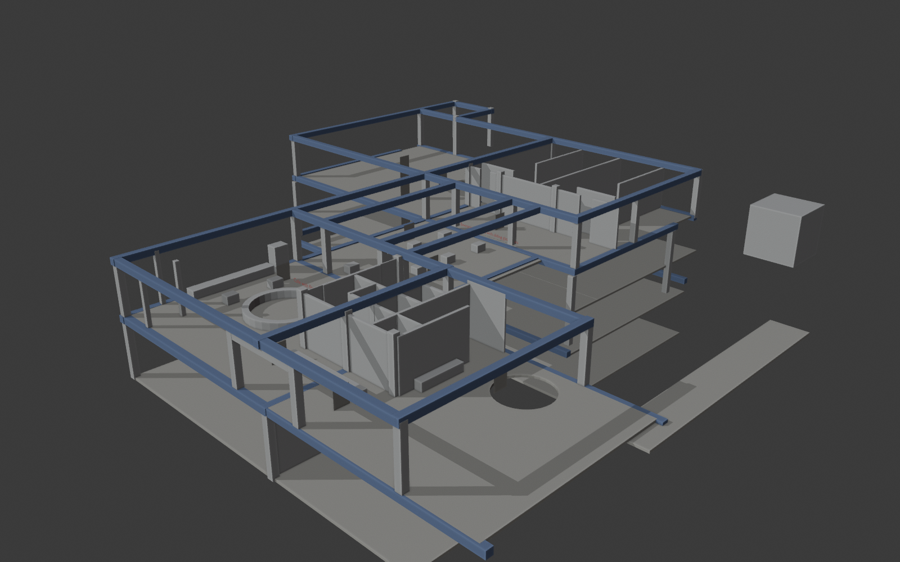
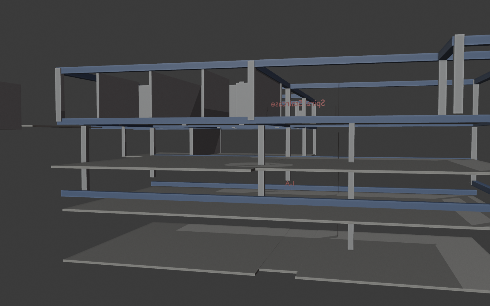
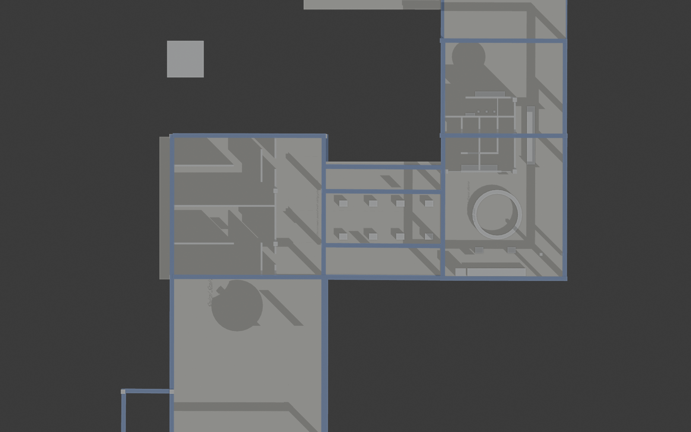

# Original: The Gym V2 (hand-made)

Roman's hand-built massing model. It's the starting intent for this project.

| | |
|---|---|
| Source file | `~/Documents/Blender_Stuff/The_Gym_V2/The_Gym_v2.blend` |
| Snapshot in repo | `reference/gym_v2_original/The_Gym_v2_snapshot_2026-09-18.blend` |
| Earlier backup | `~/Documents/Blender_Stuff/The_Gym_V2_feb16th_26.zip` (Feb 16, 2026) |
| Started / last saved | ~Feb 2026 / Sep 18, 2026 |
| Even earlier attempt | `~/Documents/Blender_Stuff/Gym_Design/gym_1.blend` (Aug 2025, just a cube + plane, ignore) |
| Units / engine | Metric, Cycles |

Roman's own note in the project folder (`notepad_notes/Test.txt`, copied here as `notepad_Test.txt`):

> Need to actually make it 4 stories and be realistic

## Floor program sketch (Roman, Aug 10, 2025)

Source: `~/Documents/Gym)1.psd`, copied here as `reference/gym_v2_original/Gym_1_floor_program.psd`. This is almost certainly the "Gym Design (1).png" that the .blend links to, which is missing from Downloads.

**A river runs north-south through the site.** The building sits on the west bank, and a **bridge** carries the 1st-floor lounge across to the east bank.

| Floor | Program |
|---|---|
| **1st** (entry) | West bank: Mens Locker, Womens Locker, Gallery, Stretching, Cardio, Calisthenics strip along the river edge, Stair, and a large **Outdoor Garden Terrace** on the west side. **Sauna** is a separate outbuilding to the north, by a **Trail**. **Bridge/Lounge** crosses the river. East bank: Reception, WC, Kitchen, Elevator, **Bike Area** (outdoor). |
| **2nd** | West bank: Free Weights with **Mirrors**, plus a "Lower Down (Step Level 3 Plats)" area. Machines, Cardio, Stair, and "Steps (Or Same Level)". East bank: **Game Room**, Elevator, **Garage ("Area for nice Cars", window)**. |
| **3rd** | Transition Area + Stairs, Calisthenics / Functional, Free Weights, Machines / Strongman / Whatever Else, Steps. Has a **River Door**. |
| **4th** | Transition Area + Stairs, **Recovery Area / Pool / Special Stuff**. Has a **River Door**. |

My read: the levels step **down** the riverbank, which is why floors 3 and 4 open onto the river. That matches the .blend, where the west wing goes 4 slabs deep into the slope, and the middle "link" is the bridge/lounge.

## Renders (workbench, generated from the snapshot)

| | |
|---|---|
|  |  |
|  |  |
|  |  |
|  | |

Colors in the renders were added only for readability: grey = walls/columns/props, beige = floor slabs, blue = perimeter beams, green = terrain, red = Roman's text labels.

## What's in the file (facts)

- 185 objects: 181 meshes and 4 text objects. Almost everything is an unnamed default `Cube.xxx` scaled into slabs, columns and walls. There are no cameras, lights or real materials yet.
- Collections: `Collection` (162 objects, the building and terrain) and `Refs` (23 objects, scale figures).
- **Scale figures:** `blender_human _ref_1` (1.48 x 1.84 m adult cutout) x 21 and `blender_child_ref_2` (0.8 x 1.0 m child cutout) x 2. Image textures come from `~/Documents/Blender_Stuff/assets/`.
- **Reference image** linked: `/home/roman/Downloads/Gym Design (1).png`. That file **no longer exists** on disk. Its source is very likely `~/Documents/Gym)1.psd` (see the floor program sketch above).
- **Text labels (Roman's design notes, placed in the model):**
  - "Spiral Staircase", over the circular void in the west wing
  - "Cafe with fitness theme", in the east wing by the round counter
  - "Environment sealed with sliding glass doors", at the boundary between the west wing and the middle link
  - "1-A", on a lower level of the west wing (a floor/unit label)
- **Structure vocabulary:** square columns are about 0.65 x 0.65 m. Perimeter beams (`Plane.0xx`, about 0.67 x 0.67 m section) sit at roughly z = +1.5 and z = -4.0. Slabs are 0.24 m thick. Walls are 0.26 m thick and about 5.1 m tall.
- **Floor-to-floor** is about 4.9 to 5.6 m (generous gym heights).
- **Terrain:** two subdivided, sculpted planes (`Plane`, `Plane.003`, about 140 to 150 m across, 10k verts each). The building sits on a hillside, with an excavation/cliff face on the west where the lower levels are exposed.

## Layout as modeled

Ground level is about z = -3.5. The overall footprint is about 68 m (E-W) x 67 m (N-S), excluding terrain.

**West wing** (x from about -29 to -6, y from about -34 to +12): this is the tall part, built into the slope.
- Slabs at z ≈ -3.6, -8.5, -13.4 and -19.0, so it's effectively **ground + 3 levels down = 4 stories**, stepping into the hill.
- The **spiral staircase** void sits at about (-19.5, -13.6), cut through the ground slab by a boolean cylinder about 7.9 m in diameter. Human figures are stacked at every level near (-10, -16.7), which reads as people on the stair and landings.
- The north half of the ground floor has a run of partition walls (about 4 to 5 m bays), probably rooms like studios, changing or offices.
- A southern extension (y down to -34) has columns and a perimeter beam but no walls.
- There's a free-standing 5.6 m cube to the northwest at (-27, 24): unlabeled, maybe a mechanical/plant block or a placeholder.

**Middle link** (x from about -6 to +12, y from about -9 to +7):
- Single storey, column grid with beams.
- 8 small boxes (1.24 x 0.93 x 0.93 m) in two rows of four. These are probably equipment or benches.
- "Environment sealed with sliding glass doors" marks where this space meets the west wing.

**East wing** (x from about +12 to +30, y from about -9 to +27):
- Two levels (slabs at z ≈ -3.5 and -9.6).
- **Cafe with fitness theme:** a round counter/bar, 7.5 m diameter and 1.35 m tall, at about (20, 0). Long counters run along the south side.
- North part: a cluster of small cell walls with sliding-door-sized panels. These read as toilets, showers or locker rooms.
- One column/beam at (30.3, 12.2) rises to about +5 m. It might be the start of an upper level.

**Site extras:** a long thin slab at the north (y ≈ 33, about 25 x 3.5 m) that looks like a path or deck, and a flat plane at z ≈ -12.8 (lower ground or lake level).

## Takeaways for the restart (my read, to confirm with Roman)

- The core concept is a **riverside hillside gym**:
  - The main building is on one bank, terraced 4 levels down toward the water, with river doors at the bottom.
  - A **bridge lounge** crosses to a reception/kitchen/garage block on the other bank.
  - It has a **sculptural spiral staircase** as the vertical spine and a **themed cafe** as the social anchor.
  - Zones are separated by **glass**.
  - Outdoor pieces: garden terrace, bike area, trail, and a separate sauna.
- The architecture is exposed frame: columns plus heavy perimeter beams, and tall ceilings.
- "Realistic" is the explicit goal, so the restart needs real dimensions, code-ish stair and egress logic, actual equipment, materials and lighting.
- The sketch and the .blend don't fully match. For example, the .blend has a cafe in the east wing, while the sketch has reception, kitchen and lounge there. The .blend also has no river geometry, just a gap in the terrain. The specs pass should settle which one wins.
- Open questions:
  - Do floors stack down the bank, as I read it?
  - What's the 5.6 m cube? Possibly the sauna, since it sits in the north, by itself.
  - What are the 8 boxes in the link?
  - Is the garage really part of it?
