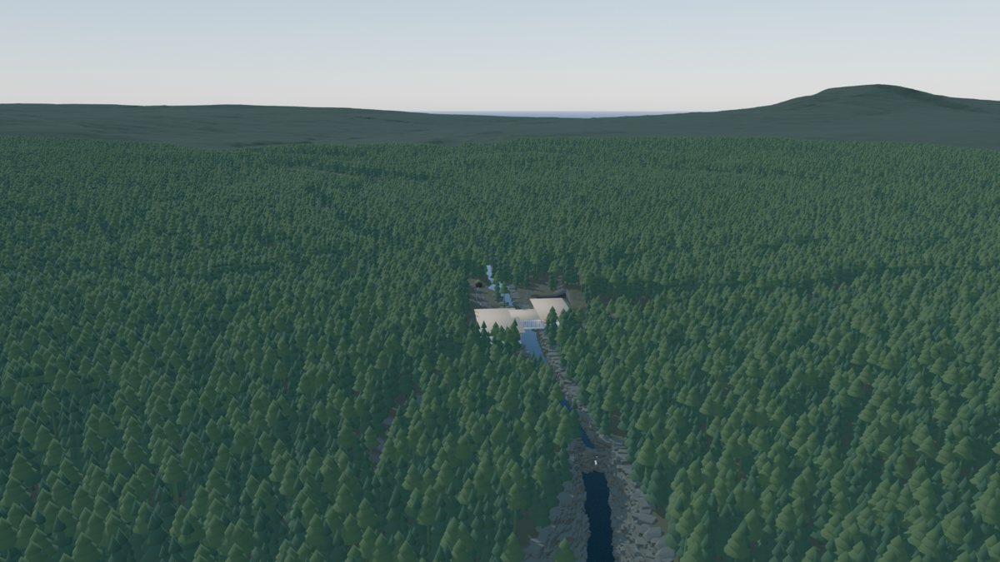
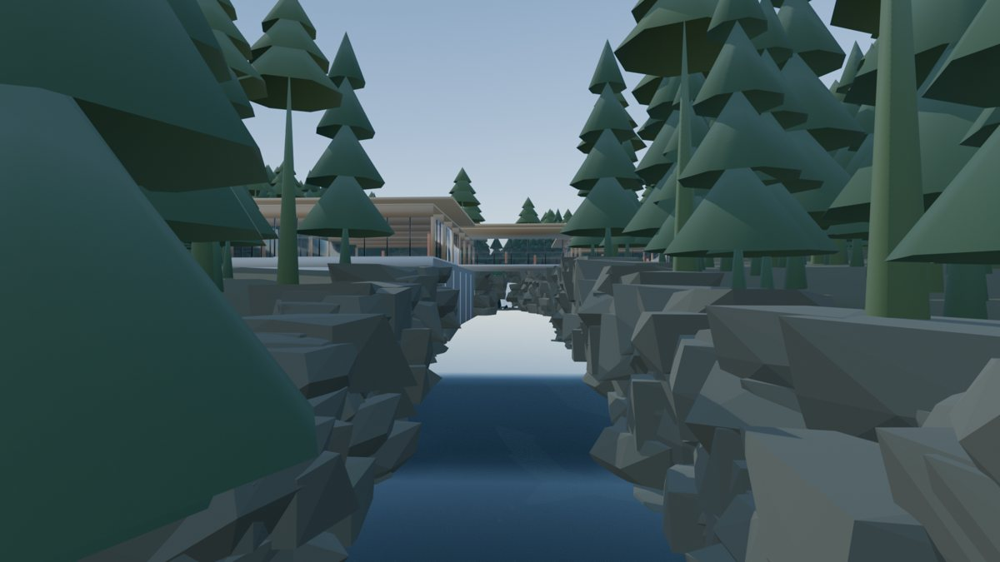
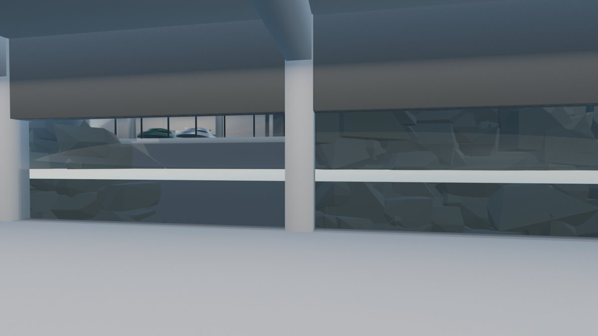
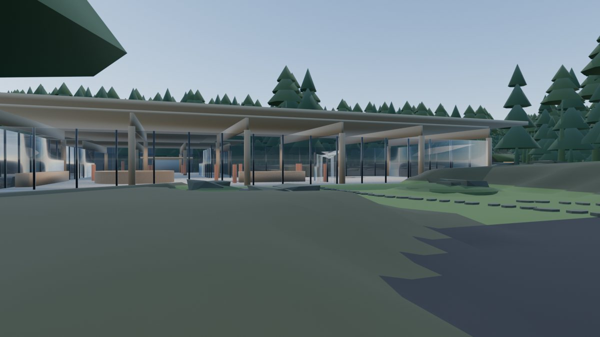
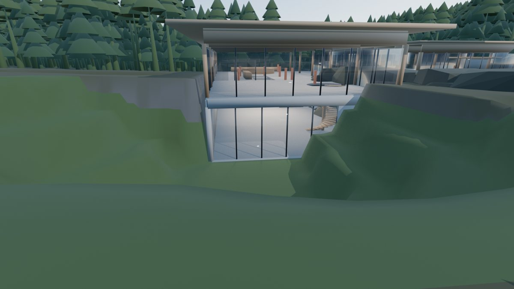
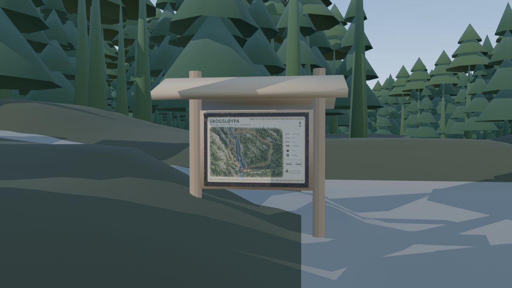
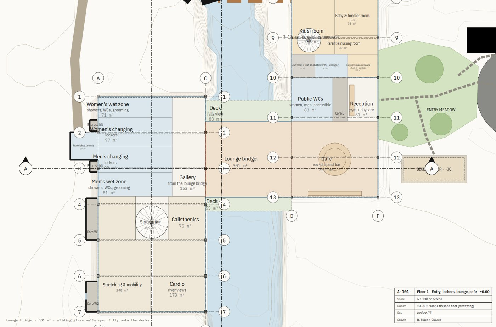
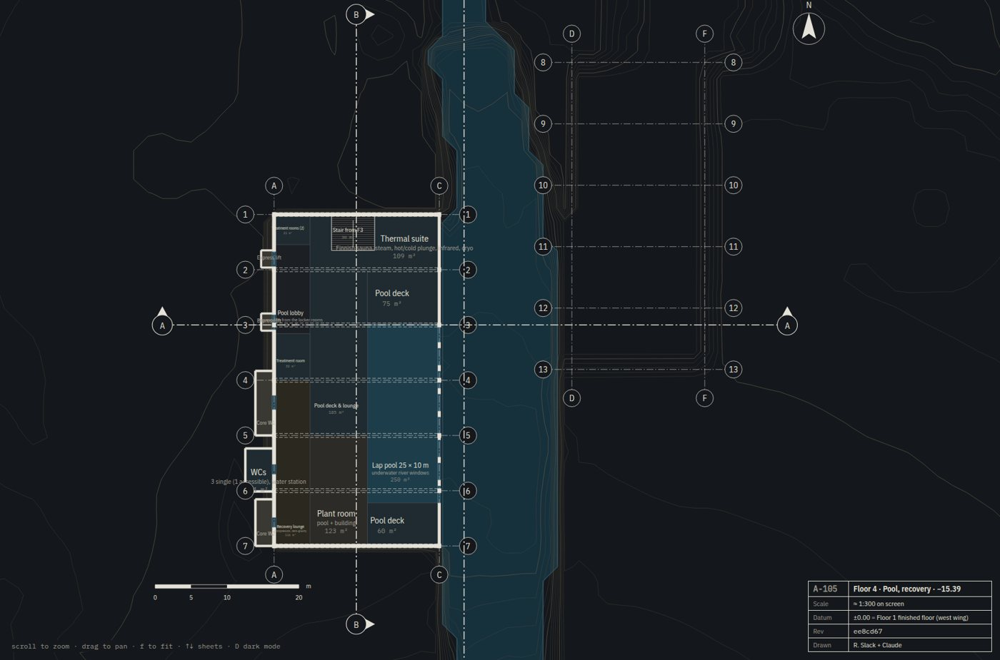
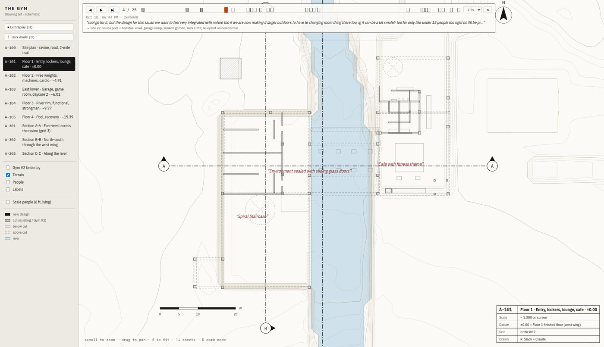

# The Gym

**A luxury Nordic gym built into a forest ravine in Elverum, Norway, designed entirely by vibe coding.** Roman describes it; Claude builds it as data, drawings and 3D, then we iterate. The building is four floors stepping down a rock ravine to below the river surface. It has a waist-high river window, a pool with underwater windows, a lounge bridge over the water, a sod-roof sauna by the stream, a drop-in daycare with a sunken garden, and a 2-mile forest loop.

It's also an experiment: **can a person and an AI picture the same building and get it to real, buildable quality, purely through conversation?** Every step is recorded, so the weeks of iteration can be replayed with the prompt behind each decision.

| | |
|---|---|
|  |  |
| *The site: real Kartverket terrain, parametric ravine, GPU erosion* | *In the gorge, looking upstream at the building and falls* |
|  |  |
| *Floor 3: the river at waist height on the glass* | *Arrival: an entry meadow with stepping stones, no parking lot in sight* |
|  |  |
| *The daycare's sunken play garden* | *The trailhead, with a map panel made by gpt-image-2* |

**Drawings.** A real architectural drawing set generated from the model: site plan, 5 floor plans, roof plan, 4 elevations, 3 sections and schedules, as A1 sheets at 1:200. Download the PDF set: [`docs/drawings/THE_GYM_drawing_set.pdf`](docs/drawings/THE_GYM_drawing_set.pdf).

| | |
|---|---|
|  |  |

**Replay.** Scrub through every version of the design. Each one shows the prompt that caused it.

*3D is placeholder geometry and materials. The focus so far is site, structure and layout.*

## Status

- [x] Document the original hand-made blockout (`reference/gym_v2_original/`, see [ORIGINAL_GYM_V2.md](ORIGINAL_GYM_V2.md))
- [x] Capture Roman's vision as ground truth ([VISION.md](VISION.md))
- [x] Recording: Stop hook checkpoints every turn (`tools/capture/checkpoint.py`, transcripts archived locally in `.capture/`)
- [x] Gym V2 extracted to data (`tools/extract_gymv2.py` → `reference/gym_v2_original/gymv2_extract.json`)
- [x] Model v0 (`model/building.json`): datum, levels, water level, section lines
- [x] Blueprint viewer v0 (`blueprint/`): site plan, floor plans, sections, Gym V2 as grey underlay
- [x] Site: real Elverum terrain (Kartverket), parametric ravine + falls + plunge pool, GPU erosion, road, garage ramp/tunnel, sunken daycare garden, sauna + pool + path (`terrain/`, every run versioned in `terrain/runs/`)
- [x] First 3D site scene in Blender (`terrain/blender_scene.py`) with rock cliff walls, forest, Gym V2 massing
- [x] Blueprint drawings on the new terrain, with site works (`model/site_terrain.json`)
- [x] 2-mile trail loop (`terrain/route_trail.py`)
- [x] Structure v2: no interior columns, wall-to-wall spans, grid + columns + beams drawn ([STRUCTURE.md](STRUCTURE.md))
- [x] Layout v1: schematic plans for every level, cores, spiral, slabs, walls; new 3D building from the model (see [DECISIONS_PENDING.md](DECISIONS_PENDING.md))
- [ ] Agree on specs (program, floors, dimensions, site, style, materials), resolving the open questions in VISION.md
- [ ] Research (references, real gym/wellness building standards)
- [ ] Decide build approach (script-driven vs. MCP live editing, repo layout)
- [ ] Build

## How it fits together

- `model/building.json` is the single source of truth for the new design. Everything else is generated from it.
- `blueprint/` is the 2D drawing set. Run `cd blueprint && npm install && npm run dev`, then open http://localhost:5280. Sheets can be linked by hash, e.g. `#A-301`. Edits to the model show up live.
- Gym V2 is drawn in grey as the "existing survey". The new design will be drawn in black on top of it.
- Coordinates match Blender world (x east, y north, z up, metres). Elevations are relative to ±0.00 = Floor 1 (Blender z −3.47).

## Not to be confused with

`~/temp/astra-experiment/nordic_gym/FOSS_Nordic_Gym.blend` is an earlier, separate, fully vibe-coded attempt (generated by `scripts/build_gym.py`). It is **not** the source of truth for this project.

## Replay

Open the drawings and press **H** (or "Replay history"). Every version of the design is shown with the prompt that led to it.
- ◀ ▶ (or ← →) step through versions, Space plays, and the timeline ticks are placed by real time.
- Any sheet and zoom works while scrubbing.
- Data comes from `tools/replay/build_history.py` (git history + archived transcripts → `blueprint/public/history/`, git-ignored). It's rebuilt automatically after every turn.

## Replay capture

- Every commit carries `Prompt:`, `Prompt-Time:` and `Session-Id:` trailers. They're added by `tools/capture/prepare-commit-msg` (enabled with `git config core.hooksPath tools/capture`, once per clone).
- A Stop hook auto-commits anything left uncommitted after each turn.
- Full transcripts are archived locally in `.capture/sessions/` (not pushed). Terrain runs are versioned in `terrain/runs/`, with animation frames in `.capture/terrain/`.
- Older commits (before 2026-10-10 20:10) can be matched to prompts by timestamp from the archived transcript.
