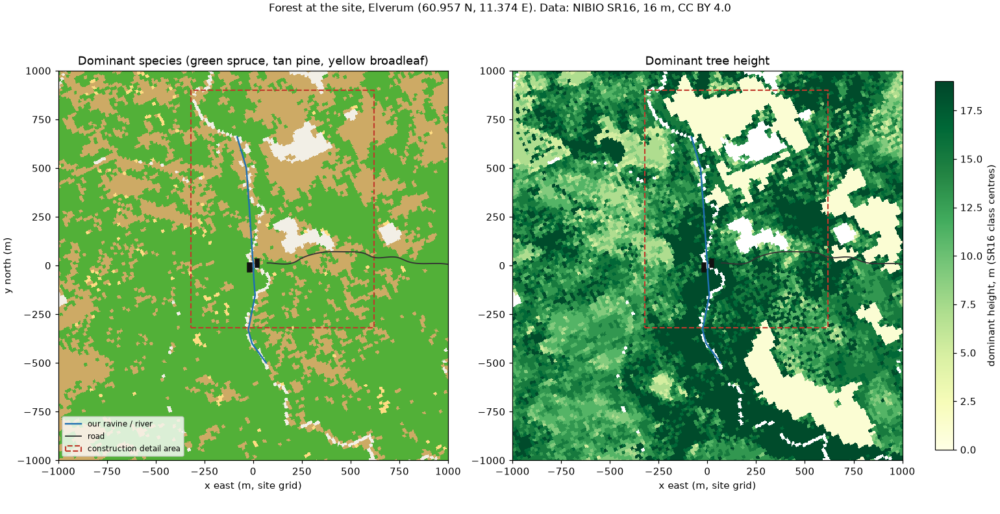

# Ecology of the site (Elverum, 60.957 N, 11.374 E)

The forest round the building is modelled on the **real** forest at our coordinates, not a guess. Data: **NIBIO SR16**, Norway's national forest resource map (laser scanning + satellite, 16 m cells, open data, CC BY 4.0, © NIBIO). `tools/forest_data.py` fetches the WMS layers, decodes them against their legends and resamples them onto the site grid → `model/forest_sr16.npz`.

## What the data says

| | Detail area (construction scenes) | 2 km square |
|---|---|---|
| Forested | 93 % | 97 % |
| Dominant species | **spruce 62 %, pine 37 %, broadleaf 1 %** | spruce 70 %, pine 29 %, broadleaf 1 % |
| Mean / dominant height | 11.1 m / top height spruce 14.0 m, pine 11.0 m | 10.9 m |
| Crown cover | 43 % (spruce 47 %, pine 35 %) | 43 % |
| Site index H40 | 8.9 (spruce 9.5, pine 7.8): low to medium productivity | 9.4 |
| Stand heights (dominant) | clear-cut / regrowth < 4 m **16 %**, young 4-10 m 8 %, mid 10-16 m 37 %, mature > 16 m 39 % | 11 / 12 / 44 / 33 % |

Reading it:
- **A managed boreal forest, spruce-dominated, with pine patches on the poorest, driest ground.** Elverum is one of Norway's most intensively managed forest districts, so stands come in age blocks: mature stands, mid-aged stands, young stands and fresh clear-cuts (our reference photo, "Frøtrær furu", is exactly that: seed pines left standing on a clear-cut).
- **The ravine is lined with a tall, mature spruce stand** (the dark band either side of the stream in the height map), which is what you see from the building.
- **Trees are shorter than I first modelled.** Typical tops are 11-14 m, the tallest class (> 17 m) is common in mature stands; a big old tree is ~20-24 m, not the norm.
- **Broadleaf is only 1 % as the dominant species**, but birch is the normal admixture in both spruce and pine stands, and the streamside is where broadleaf belongs (grey alder, birch, rowan, willow). SR16 can't see an admixture, so that part is inferred.
- The real stream (SR16's no-data line) runs right where our parametric ravine runs.

## How the build uses it (the scatter)

1. **Species per 16 m cell** from SR16 (spruce / pine / broadleaf), plus a **~8 % birch admixture** scattered through spruce and pine stands, and a **streamside belt** (within ~15 m of the water in our ravine) of birch, grey alder and rowan.
2. **Heights per cell:** each tree's height is drawn around the cell's dominant height (0.75-1.05 × top height), so stands read as stands; a few veterans in mature cells.
3. **Density from crown cover:** trees per cell = cover × cell area / crown area of that species at that height (so 47 % cover of 14 m spruce ≈ 300 trees/ha, pine sparser).
4. **Clear-cut cells (< 4 m)** get regrowth instead: young spruce and birch 1-4 m, the odd seed pine left standing (as in the reference photo).
5. **Ground layer by stand type** (inferred from species + site index, to be checked against NiN vegetation maps later):
   - under spruce: bilberry (blåbær) + feather mosses, dark and soft (blåbærgranskog)
   - under pine on the poorest ground: lingonberry (tyttebær), heather (røsslyng), crowberry, reindeer lichen (Cladonia) on the driest knolls
   - clear-cuts: wavy hair-grass, fireweed, raspberry, birch and spruce seedlings
   - streamside: ferns, moss on the rocks, grasses
6. **Our site:** the building, road, garden, paths, trail and keep-out margins are cleared (SR16 shows forest there today).

## Species to generate (all ours, see `construction/trees.py`)

| Species | Status |
|---|---|
| Norway spruce (*Picea abies*) | done (LOD 0 / 1 / impostor) |
| Scots pine (*Pinus sylvestris*) | done, crown shape pass next (real heights 9-18 m) |
| Birch (*Betula pubescens / pendula*) | to do: admixture + streamside |
| Grey alder (*Alnus incana*), rowan (*Sorbus aucuparia*) | to do: streamside |
| Young spruce / birch regrowth 1-4 m | from the same generators at small heights |
| Ground layer: bilberry, lingonberry, heather, moss, lichen, wavy hair-grass, ferns | to do (generated tufts / sprigs, scattered by stand type) |

Caveats: SR16 is a model (classes, 16 m), it sees dominance not admixture, and the ground layer is inferred from species and site index, not measured.
