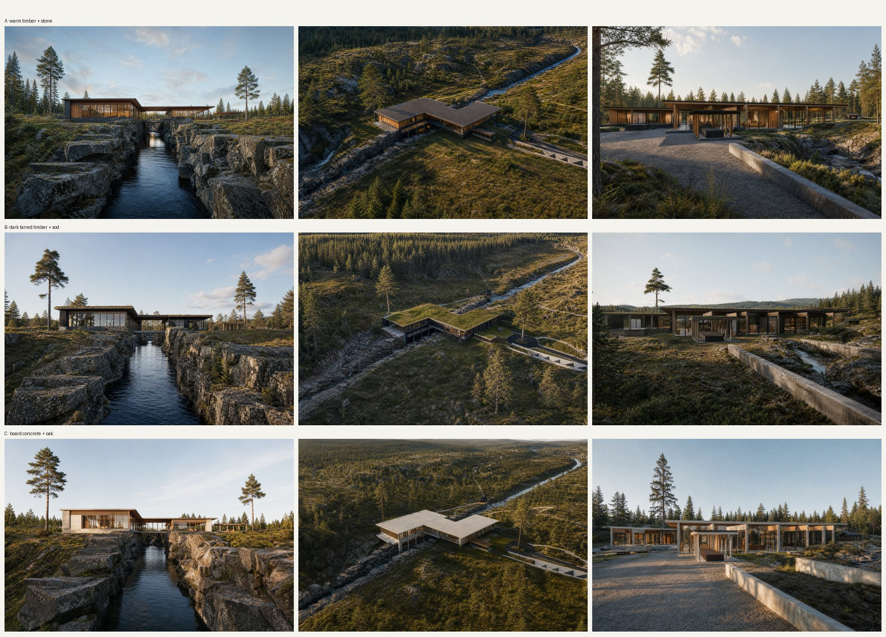

# Stage 2 · Exterior style exploration

gpt-image-2 renders built on clean renders of our real massing (`ref_*.png`), so the geometry stays ours. Prompts are in `batch.jsonl`; each image's full spec is in its `gen/*.json`. Medium quality, 1536×1024. Round v1 cost $0.37.

| | Direction |
|---|---|
| **A** | Warm vertical pine cladding, dark granite base + stair towers, thin flat roofs with deep timber soffits, slim black frames |
| **B** | Black tarred timber, **sod roofs**, weathered oak, stone plinth |
| **C** | Light board-formed concrete, oak louvres + soffits, razor-thin roof edges, full-height glass |

Roman picks (or mixes), then it's locked into VISION.md.

**Decision (2026-10-11): B.** Dark tarred timber, sod roofs, divided (not giant single-pane) glazing.
