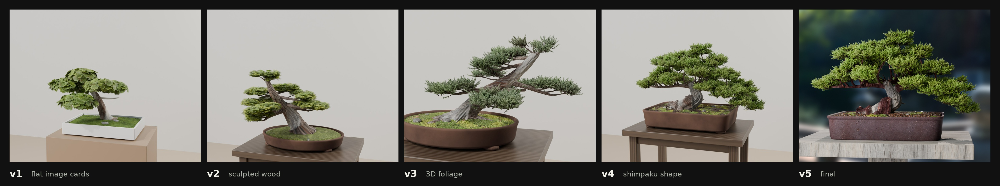

# How we got photoreal procedural plants (and a bonsai good enough to post)

One afternoon (2026-11-02), one person giving feedback in plain words and one AI writing code, Blender rendering on a
home GPU. No hand modelling, no bought assets. Every plant is generated by a script from a seed, so no two are alike.

This doc covers what we built, the feedback that drove each step, what actually made the difference, and a recipe for
doing the same with anything else.

---

## What came out of it

| | what | file |
|---|---|---|
| Nordic moss on granite, dry and wet | a PBR material study | `materials/nordic_moss/` |
| Boston fern | ~1.3 M faces of procedural fronds, "literally photo real" on the first try | `plants/gen_fern.py` |
| Monstera | glossy leaves from an image atlas, no leaf clipping | `plants/gen_monstera.py` |
| Snake plant | sword leaves, green and Laurentii varieties | `plants/gen_snake.py` |
| Juniper bonsai, two styles | sculpted deadwood trunk, 3D foliage, real pot and soil | `plants/gen_bonsai.py` |
| The X post set | 2160 x 2700 renders, close-ups, the iterations sheet | `plants/out/x_posts/` |

Cost: about $7 of image generation for the day (Gemini "Nano Banana 2" at ~$0.10 an image), plus electricity. Every
render ran on one RTX 4070 Super, 15 seconds to 2 minutes each.

---

## The one idea that mattered

**Realism comes from real-looking images, not from patterns written in code.**

Every time something looked fake, it was because a surface had been *drawn* by code: straight veins, perfect holes, even
colour, a uniform noise. Every time it jumped to photoreal, it was because we started from photos instead:

1. Find real reference photos (Wikimedia Commons, all licensed, credits kept in `refs/sources.json`).
2. Feed those photos to an image model and generate the *pieces* we need, isolated and evenly lit: one leaf flat on
   white, a 10 cm square of bark shot straight on, a top-down patch of moss.
3. Cut them out or make them tileable with a small script.
4. Let code do only what code is good at: **structure and variety.** Where the branches go, how a leaf bends, which way
   it faces, how big it is, its slight colour shift, so every plant from a different seed is a different plant.

The one exception: when single elements are too small to see (the fern's thousands of leaflets, the juniper's scale
shoots), building them entirely in geometry works, because the eye only reads the overall pattern.

---

## How it went, with the feedback that drove it

Roman's words are quoted as typed. Each line is one round: what he said, what was wrong, what fixed it.

### The moss study

- *"save this for later"*: an X post about making PBR textures from one reference photo. We kept it
  (`docs/reference/pbr_from_single_reference.md`) and used its method.
- *"should we do one for like realistic mossy rock walls ... in the interior design of the gym?"* Built a cushion-moss on
  Elverum granite material: Gemini albedo from CC0 scans, every map aligned to it with optical flow
  (`tools/pbr_align.py`), moss as a separate layer that can grow or shrink.
- *"do a wet version please ... like it was raining or had water flowing over it"*, then *"look up wet references of
  moss and stone"*. The references taught two things we'd got wrong: wet moss goes *more* vivid, not darker, and the
  wetness reads from real droplets, so we placed 45,000 actual water beads (IOR 1.33) on the moss tips.

### The fern: right first time

- *"extremely high detail, let's do one or 2 first then we'll tweak those to lay the level of quality and standards"*
- Every number came off the reference photos: 75-110 fronds, leaflets 9 mm apart, the little lobe at each leaflet's base,
  croziers in the middle, old fronds browning. Two real bugs on the way: leaflets spaced at double the gap (fronds like
  bead strings) and a rim-guard that flattened every frond (a starfish).
- *"that fern is literally photo real holy crap"*

### The monstera: the lesson

- First version: leaves *drawn in code*. *"this one doesn't look very photoreal to me idk?"* and *"the sheen is weird and
  plasticky"*.
- I had been judging it against my own earlier versions instead of against the photos. Rebuilt with 8 generated
  flat-lay leaf photos, cut out (`build_leaf_atlas.py`), and a satin material instead of a clear coat.
- *"umm that is perhaps 100x better wtf?"*
- *"some of the leaves are clipping through each other, fix that first"*: every leaf now tries up to 30 placements and
  keeps one at least 1.5 cm clear of every other leaf, the stems, the pot and the floor.

### The bonsai: nine rounds

1. **v1**, a bent tube with a bark picture, flat pads of image cards. *"nah looks weird af"*. A bonsai's whole character
   is its wood, and that was the part built purely in code.
2. **Sculpted wood.** *"yes actually make good"*. Trunk, roots and branches as tubes fused into one body (Blender voxel
   remesh), then carved: twisting fibre ridges, knots, the bleached deadwood band sunk in with raised live-bark edges.
   *"they look way way better, keep going ... to get perfect"*.
3. **Foliage.** *"looks like a classic particle scatter ... not natural up close"*, then *"I could be tweaking though if
   you show me like a real up close image"*. Putting a real Shimpaku close-up next to ours settled it: *"yeah definitely
   way off, they are way too just 2D cards"*. Rebuilt as grown 3D geometry: every twig tip sends out shoots, each a stem
   clothed in round scale-covered cords, ~2.6 M faces. *"bro it's 100x better again holy shit, just a little too dark"*.
4. **Shape.** *"make one that is like the reference shimpaku bonsai with that same shape"*. Three tries: *"nah shape is
   weird"*, *"nah you are missing the sauce"*, then *"getting there yes we are so close"*. The sauce was that the
   reference is a short, thick, contorted trunk under a wide, low, lopsided mound of separate cloud clumps, not a tall
   trunk under a round dome. Proportions, not detail.
5. **Branches.** *"the branches look at some strange almost 90 degree angles"*. Every branch now leaves its parent
   along the parent's direction and curves onto its target.
6. **The post.** *"need more interesting background ... for an X post"*. A real garden (Poly Haven HDRI), a weathered
   stand, a 70 mm lens, the sun behind as a rim light. Rendered the tree and the background as separate passes and blurred
   the background in post: blurring it in the renderer came out as banded blotches.
7. **Pot.** *"pot looks bad"*. Same lesson as the monstera: a generated 4K photo texture of aged Tokoname clay.
8. **Bark.** *"the bark ... comes across as plasticky"*. 4K macro textures of peeling bark and bleached deadwood, fully
   matte, projected so they can't stretch. *"the closeups of the bark look spectacular"*.
9. **Soil.** *"the moss ground and dirt ruins it ... needs to be 10x better to match the bark"*. Four rounds: 24,000 real
   3D grit granules (akadama, lava, pumice); a smear fixed; stretched moss fixed; then *"no detail at all on the mossy
   part ... specialize it for a close-up"*, so the moss became 20,000 real shoots, each a stem with 12 spiralling leaves.

Also: *"make all images perfect resolution for x.com"*, so every post render is 2160 x 2700 (4:5) with an upload JPEG
under 5 MB. And *"your red maple one is ugly"*: dropped it, made a second juniper in the blue glazed pot instead.

---

## What made the difference (the rules we ended up with)

1. **Images for surfaces, code for structure.** See above. Saved as a working rule.
2. **Compare against the real photo, side by side, every time.** The biggest jumps came the moment a real close-up sat
   next to ours. Comparing against your own previous version drifts.
3. **Ask "what is this thing's character?" first.** A fern is its thousands of leaflets. A monstera is its big glossy
   leaves. A bonsai is its wood and silhouette. Spend the effort there; that part must be real.
4. **Structure follows growth.** Branches leave their parent along its direction and curve; shoots grow out from twig
   tips; leaves fan from petioles. Random scatter reads fake instantly.
5. **Nothing intersects.** A clipping leaf ruins a photoreal image. Check every placement against everything already
   placed.
6. **Matte unless you know it's shiny.** Most of the "plastic" complaints were a uniform sheen. Real bark, deadwood, clay
   and moss barely reflect.
7. **Proportion beats detail.** Three rounds of "the shape is weird" were all proportions: trunk length, canopy width,
   where the mass sits.
8. **Plain feedback is enough.** "weird af", "missing the sauce", "plasticky" each pointed at exactly one fixable thing.
   Short honest reactions, fast iterations.

---

## Replicating it for something else

Say you want a procedural olive tree, a rock garden or a fabric.

1. **References.** 10-20 real photos: the whole object, mid distance, and macro close-ups of each surface.
   `python3 -I /tmp/refscripts/commons.py plants/refs '[["olive","Olea europaea tree",6]]'` (or any photo source).
2. **Name its character** in one line, and list every number you can read off the photos (sizes, counts, angles,
   spacing, colours).
3. **Generate the pieces** from the references, isolated and evenly lit:
   - leaves: *"ONE single real [leaf] laid perfectly flat, seen straight from above, tip UP, stem at the BOTTOM, pure
     white seamless background, soft even light, no shadows, ultra sharp"*, 6-8 variants (young to old, a damaged one)
   - surfaces: *"Seamless tileable macro texture photograph, a 10 x 10 cm patch shot straight on in soft even light: [the
     surface] ... fills the frame edge to edge"*, 4K
   - pass the reference photos with `--refs`; about $0.10 each on Gemini Nano Banana 2.
4. **Cut out / make tileable:** `python3 plants/build_leaf_atlas.py <plant>` for leaves; for textures, the wrap-blend
   in the bark step (cross-fade each edge into the opposite one) plus a height map from the image's high-pass.
5. **Write the generator** `plants/gen_<thing>.py` with `build(seed, loc)` and a `FRAME` dict: the structure grown in
   code, the pieces placed on it, the clipping check, per-instance tint and mirroring.
6. **Render and compare:** `plants/render_plant.py <thing> hero|trio|close|backlit out.png`, then put it beside the
   reference photo. Fix the single worst thing. Repeat.
7. **Post shot:** `plants/render_bonsai_post.py` (garden HDRI, 70 mm, two passes) then `plants/post_composite.py`.

Render politely: one shot per Blender process, `nice -n 19`, a 12 GB memory cap, GPU only.

---

## Files

- `plants/gen_*.py`: the generators (fern, monstera, snake, bonsai, maple)
- `plants/build_leaf_atlas.py`: generated leaf photos into clean cut-outs
- `plants/render_plant.py`, `render_bonsai_post.py`, `post_composite.py`, `stage.py`: rendering
- `plants/maps/`: every generated texture and cut-out leaf
- `plants/out/`: every progress image, never overwritten (`_vNNN`), also in the replay
  (`.capture/renders/replay.html`, cameras "material plants/...")
- `plants/PROGRESS.md`: the full log, one line per step
- `materials/nordic_moss/`: the moss study
